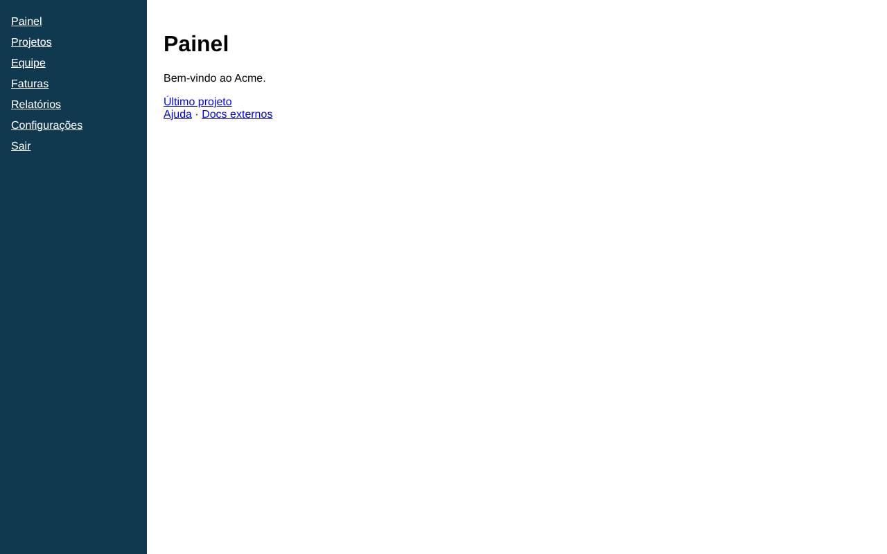
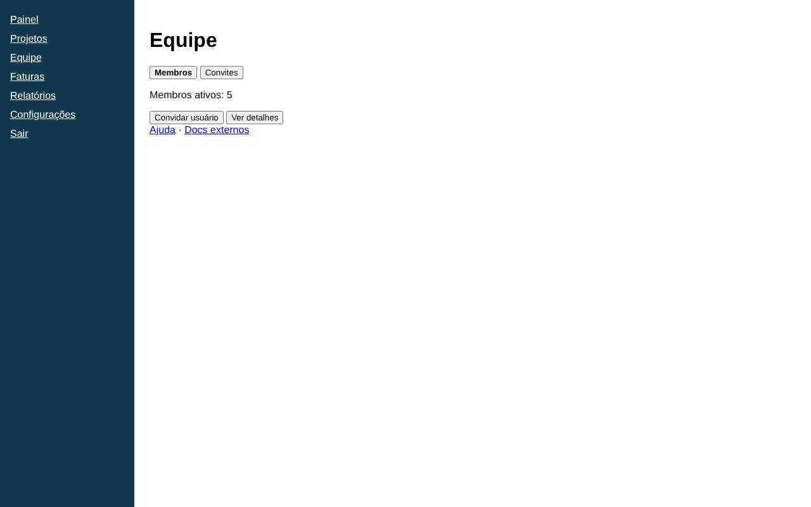
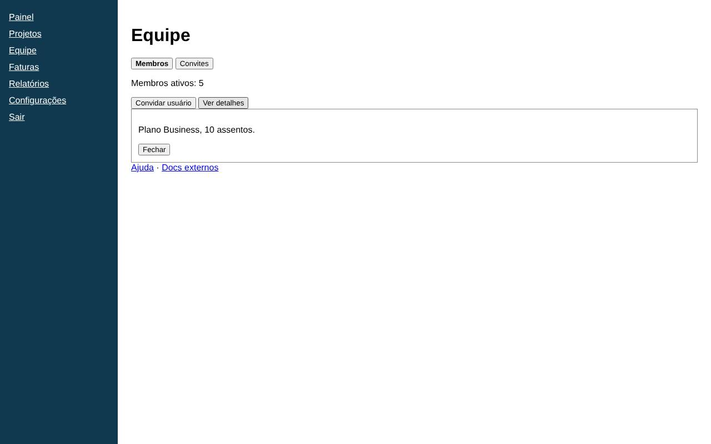

# Fluxo: Ver os detalhes da equipe

**Resultado:** Aprovado

**Objetivo:** Abrir a tela de equipe e ver os detalhes do plano contratado.

**Critério de sucesso:** o texto com o plano e a quantidade de assentos aparece na tela.

**Parecer:** Todos os passos e verificações satisfeitos. Passo 3 aprovado pelo Judge: Depois de clicar em "Ver detalhes", abriu-se um painel com o texto "Plano Business, 10 assentos." e um botão "Fechar". O mesmo texto aparece na captura de tela e no texto observado, então o plano e a quantidade de assentos estão visíveis.

**Telas visitadas:** [team](../telas/team.md)

## Passo a passo

### 1. Abrir a tela de equipe pelo menu principal (pass)

Antes: 

Depois: 

### 2. Clicar em 'Ver detalhes' para exibir os detalhes do plano contratado (pass)

Antes: 

Depois: 

### 3. Critério de sucesso: o texto com o plano e a quantidade de assentos aparece na tela. (pass)

Depois: 
