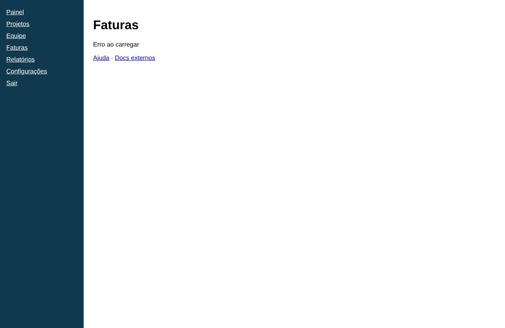

# Faturas

- **Rota:** `/billing`
- **Exemplos visitados:** `http://127.0.0.1:4020/billing`
- **Caminho:** Início › Faturas

## Achados (5)

### **ALTA** · Técnico · HTTP 500 em GET /api/invoices

A requisição GET /api/invoices respondeu com status 500.

**Evidências**

- GET http://127.0.0.1:4020/api/invoices → 500

**Como reproduzir**

1. Início
2. Faturas

**Sugestão:** Investigar o erro no servidor (logs da API).

`id: 323f2d8dee`

### **MÉDIA** · Técnico · Erro no console: Falha ao carregar faturas: 500

A página registrou um erro no console: Falha ao carregar faturas: 500

**Evidências**

- console.error: Falha ao carregar faturas: 500

**Como reproduzir**

1. Início
2. Faturas

`id: 2d4e419975`

### **MÉDIA** · UX · Erro sem destaque visual

> Opinião do agente (confiança 75%): não é uma medição objetiva.

A mensagem de erro usa o mesmo estilo do texto comum: preto, sem ícone, sem cor de alerta e sem contêiner. Ela não se destaca como um estado de erro.

**Evidências**

- "Erro ao carregar" aparece em texto simples, com o mesmo peso dos demais textos da página

**Como reproduzir**

1. Início
2. Faturas

**Sugestão:** Mostrar o erro em um bloco de alerta, com ícone e cor de erro, e respeitando o contraste exigido para acessibilidade.

`id: 1cb3073145`

### **MÉDIA** · UX · Mensagem de erro genérica e sem explicação

> Opinião do agente (confiança 90%): não é uma medição objetiva.

A tela mostra só "Erro ao carregar". Não diz o que falhou (lista de faturas?), por que falhou nem se o problema é temporário. O usuário fica sem saber o estado das próprias faturas.

**Evidências**

- Texto "Erro ao carregar" logo abaixo do título "Faturas"

**Como reproduzir**

1. Início
2. Faturas

**Sugestão:** Trocar por uma mensagem específica, como "Não foi possível carregar suas faturas. Verifique sua conexão e tente novamente", com a causa quando ela for conhecida.

`id: ef98c004fb`

### **MÉDIA** · UX · Nenhuma ação de recuperação após o erro

> Opinião do agente (confiança 85%): não é uma medição objetiva.

Não há botão para tentar de novo nem caminho alternativo, como falar com o suporte. Para recuperar a tela, o usuário precisa recarregar a página por conta própria.

**Evidências**

- Abaixo de "Erro ao carregar" só aparecem os links "Ajuda · Docs externos", sem botão "Tentar novamente"

**Como reproduzir**

1. Início
2. Faturas

**Sugestão:** Adicionar um botão principal "Tentar novamente" e, se possível, um link para o suporte de cobrança.

`id: defa631eb1`
