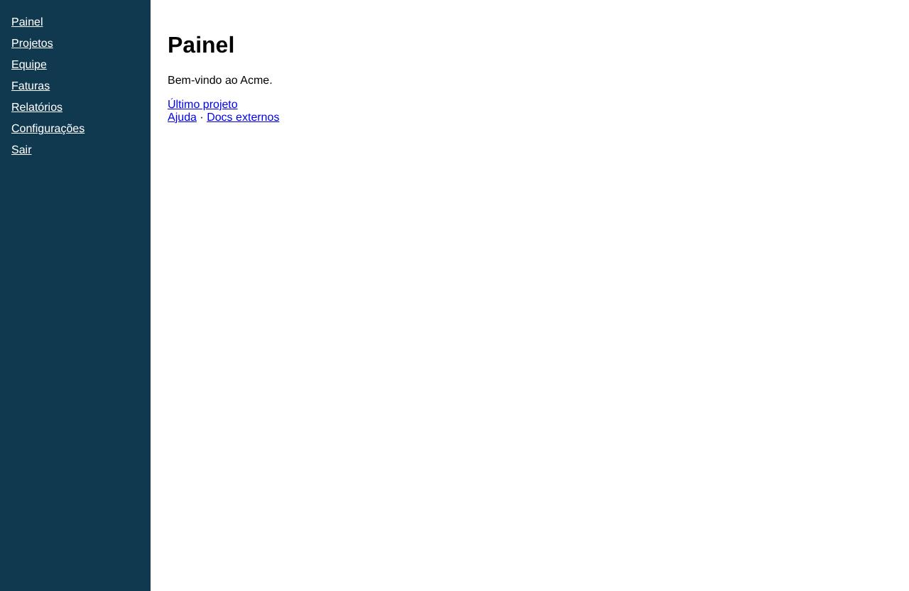

# Painel

- **Rota:** `/dashboard`
- **Exemplos visitados:** `http://127.0.0.1:4020/dashboard`
- **Caminho:** Início

## Achados (6)

### **ALTA** · Técnico · Exceção JavaScript não tratada: undefinedHelper is not defined

A página lançou uma exceção que não foi capturada: undefinedHelper is not defined

**Evidências**

- Exceção: undefinedHelper is not defined

**Como reproduzir**

1. Início

**Sugestão:** Tratar o erro ou corrigir a referência indefinida; erros não tratados costumam quebrar a interface.

`id: fc58b53f3e` · afeta: dashboard, projects

### **MÉDIA** · UX · "Sair" aparece junto com os itens de navegação

> Opinião do agente (confiança 65%): não é uma medição objetiva.

"Sair" é uma ação destrutiva (encerra a sessão), mas aparece logo abaixo de "Configurações", com o mesmo estilo dos links de navegação. Isso aumenta o risco de clique sem querer.

**Evidências**

- Lista lateral: "Configurações" seguido de "Sair", sem separador e com o mesmo estilo.

**Como reproduzir**

1. Início

**Sugestão:** Separar "Sair" visualmente, por exemplo no rodapé do menu ou no menu do usuário, com um divisor.

`id: 35bc08d437`

### **MÉDIA** · UX · Menu lateral não indica a página atual

> Opinião do agente (confiança 80%): não é uma medição objetiva.

Na navegação lateral, "Painel" tem o mesmo estilo dos outros itens, mesmo sendo a página aberta. Sem destaque, o usuário não percebe onde está.

**Evidências**

- Menu lateral: "Painel", "Projetos", "Equipe"... aparecem todos sublinhados, com a mesma cor e o mesmo peso, sem destaque para "Painel".

**Como reproduzir**

1. Início

**Sugestão:** Destacar o item ativo com fundo, negrito ou um indicador lateral e usar aria-current="page".

`id: 98a0d3cd7b`

### **MÉDIA** · UX · Painel sem conteúdo útil e com hierarquia fraca

> Opinião do agente (confiança 60%): não é uma medição objetiva.

A página principal mostra só uma saudação e três links soltos. Não há resumo, métricas nem ações principais, e quase toda a área fica vazia.

**Evidências**

- Conteúdo: "Bem-vindo ao Acme." / "Último projeto" / "Ajuda · Docs externos" e o resto da tela em branco.

**Como reproduzir**

1. Início

**Sugestão:** Incluir cartões de resumo (projetos, faturas pendentes, atividade recente) e uma ação principal bem visível.

`id: c06b20d8b6`

### **BAIXA** · UX · Link externo sem indicação e misturado com links de ajuda

> Opinião do agente (confiança 55%): não é uma medição objetiva.

"Docs externos" leva para fora do app, mas tem o mesmo estilo de "Ajuda", sem ícone de link externo. Além disso, os links de suporte ficam colados em "Último projeto", sem separação entre tipos de conteúdo diferentes.

**Evidências**

- "Ajuda · Docs externos" logo abaixo de "Último projeto", sem espaço nem ícone de link externo.

**Como reproduzir**

1. Início

**Sugestão:** Adicionar um ícone de link externo e agrupar os links de suporte em uma seção separada.

`id: fd262b1c27`

### **BAIXA** · UX · Rótulo "Último projeto" é vago

> Opinião do agente (confiança 70%): não é uma medição objetiva.

O link não diz qual é o projeto nem quando foi acessado. O usuário só descobre o destino depois de clicar.

**Evidências**

- Link "Último projeto" sem o nome do projeto.

**Como reproduzir**

1. Início

**Sugestão:** Mostrar o nome e a data, por exemplo: "Continuar: Projeto X (editado ontem)".

`id: 35fe6df495`
