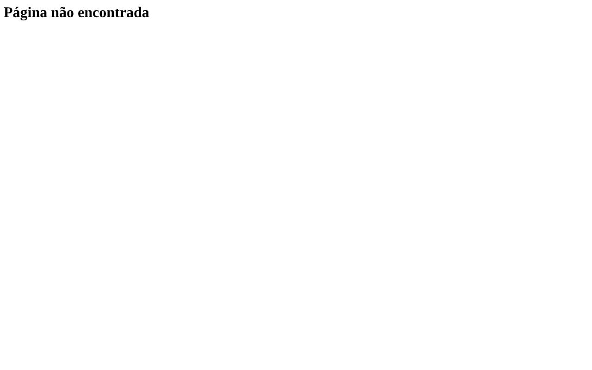

# Página não encontrada

- **Rota:** `/help`
- **Exemplos visitados:** `http://127.0.0.1:4020/help`
- **Caminho:** Início › Ajuda

## Achados (8)

### **ALTA** · Acessibilidade · Acessibilidade: <html> element must have a lang attribute

Ensure every HTML document has a lang attribute. Regra axe `html-has-lang`. https://dequeuniversity.com/rules/axe/4.14/html-has-lang?application=playwright

**Evidências**

- /help: html

**Como reproduzir**

1. Início
2. Ajuda

**Sugestão:** The <html> element does not have a lang attribute

`id: 98cabb27ac`

### **ALTA** · Acessibilidade · Acessibilidade: Documents must have <title> element to aid in navigation

Ensure each HTML document contains a non-empty <title> element. Regra axe `document-title`. https://dequeuniversity.com/rules/axe/4.14/document-title?application=playwright

**Evidências**

- /help: html

**Como reproduzir**

1. Início
2. Ajuda

**Sugestão:** Document does not have a non-empty <title> element

`id: 17ad4e8bdd`

### **MÉDIA** · Acessibilidade · Acessibilidade: All page content should be contained by landmarks

Ensure all page content is contained by landmarks. Regra axe `region`. https://dequeuniversity.com/rules/axe/4.14/region?application=playwright

**Evidências**

- /help: h1

**Como reproduzir**

1. Início
2. Ajuda

**Sugestão:** Some page content is not contained by landmarks

`id: a70e66eee2`

### **MÉDIA** · Acessibilidade · Acessibilidade: Document should have one main landmark

Ensure the document has a main landmark. Regra axe `landmark-one-main`. https://dequeuniversity.com/rules/axe/4.14/landmark-one-main?application=playwright

**Evidências**

- /help: html

**Como reproduzir**

1. Início
2. Ajuda

**Sugestão:** Document does not have a main landmark

`id: 1364f07991`

### **MÉDIA** · Técnico · HTTP 404 ao abrir a tela

A própria página respondeu com status 404.

**Evidências**

- GET http://127.0.0.1:4020/help → 404

**Como reproduzir**

1. Início
2. Ajuda

`id: d1401154cc`

### **MÉDIA** · UX · Página 404 sem o layout do app e sem nenhuma navegação

> Opinião do agente (confiança 75%): não é uma medição objetiva.

A página de erro não tem menu lateral, cabeçalho nem rodapé, ao contrário das outras telas do aplicativo. Sem nenhum elemento além do título, o usuário fica preso e precisa usar o botão Voltar do navegador ou digitar outra URL.

**Evidências**

- A tela inteira é branca e o único elemento é o título "Página não encontrada", no canto superior esquerdo, sem estilo próprio.

**Como reproduzir**

1. Início
2. Ajuda

**Sugestão:** Mostrar a página 404 dentro do layout padrão do app e incluir links visíveis, como "Voltar ao painel" e "Ir para a Ajuda", além de uma busca.

`id: 45c5fc50c5`

### **MÉDIA** · UX · Página de erro sem estilo visual e sem hierarquia

> Opinião do agente (confiança 60%): não é uma medição objetiva.

O título aparece com a fonte serifada padrão do navegador, encostado no canto da tela, e o resto da tela fica vazio. Isso não segue a identidade visual do app e não deixa claro se o problema é do usuário ou do sistema.

**Evidências**

- O título "Página não encontrada" aparece em fonte serifada padrão do navegador, no canto superior esquerdo, e o resto da tela está em branco.

**Como reproduzir**

1. Início
2. Ajuda

**Sugestão:** Aplicar a tipografia e o espaçamento do design system, centralizar o conteúdo e acrescentar um texto curto explicando o que aconteceu.

`id: c0e96facbc`

### **MÉDIA** · UX · Rota de Ajuda (/help) leva a uma página 404

> Opinião do agente (confiança 80%): não é uma medição objetiva.

O usuário que procura ajuda cai numa página de erro. Isso quebra o fluxo de suporte justamente quando ele precisa de orientação, e passa a impressão de que o produto está quebrado.

**Evidências**

- A tela da rota /help mostra apenas o título "Página não encontrada".

**Como reproduzir**

1. Início
2. Ajuda

**Sugestão:** Publicar a página de Ajuda nessa rota ou corrigir os links que apontam para /help, levando o usuário ao destino certo (central de ajuda ou documentação).

`id: b663d3f4f5`
