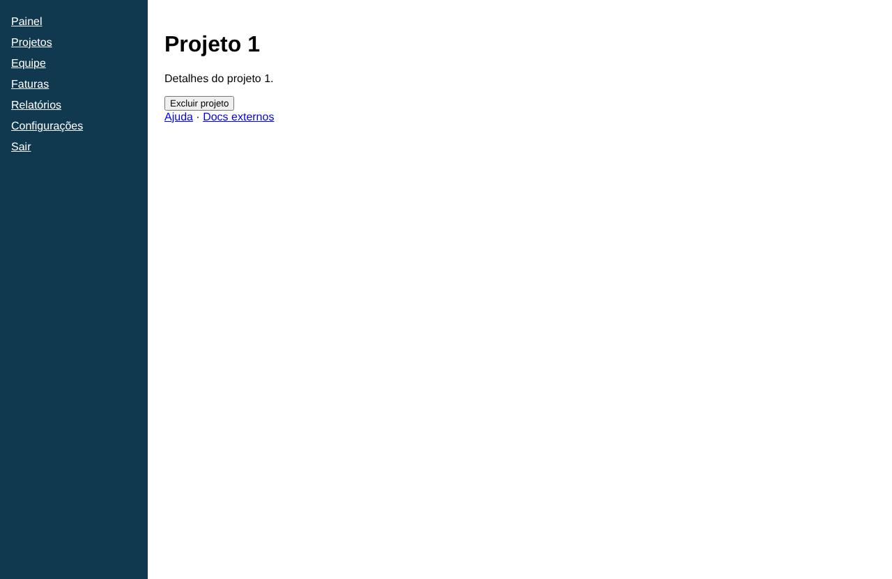

# Projeto 1

- **Rota:** `/projects/:id`
- **Exemplos visitados:** `http://127.0.0.1:4020/projects/1`, `http://127.0.0.1:4020/projects/2`, `http://127.0.0.1:4020/projects/3`
- **Caminho:** Início › Último projeto

## Achados (0)

Nenhum achado nesta tela.
