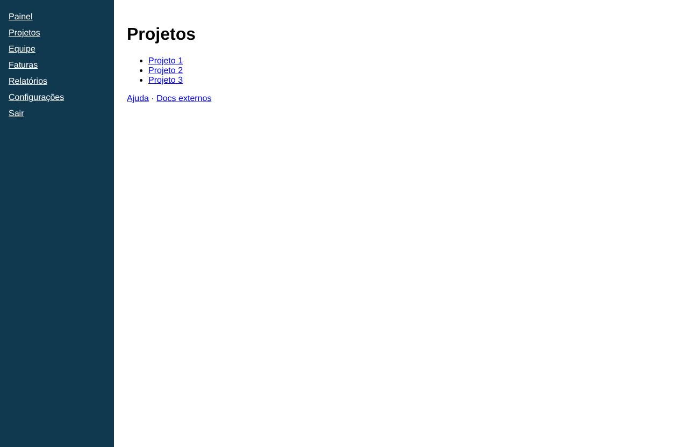

# Projetos

- **Rota:** `/projects`
- **Exemplos visitados:** `http://127.0.0.1:4020/projects`
- **Caminho:** Início › Projetos

## Achados (5)

### **ALTA** · Técnico · Exceção JavaScript não tratada: undefinedHelper is not defined

A página lançou uma exceção que não foi capturada: undefinedHelper is not defined

**Evidências**

- Exceção: undefinedHelper is not defined

**Como reproduzir**

1. Início

**Sugestão:** Tratar o erro ou corrigir a referência indefinida; erros não tratados costumam quebrar a interface.

`id: fc58b53f3e` · afeta: dashboard, projects

### **MÉDIA** · UX · Hierarquia visual fraca e espaço vazio

> Opinião do agente (confiança 60%): não é uma medição objetiva.

O conteúdo fica concentrado no canto superior esquerdo, em texto pequeno de link padrão, e a maior parte da área principal fica em branco. Os itens da lista estão muito juntos, o que deixa as áreas de clique pequenas.

**Evidências**

- Lista com marcadores "Projeto 1/2/3" em espaçamento simples e o restante da área à direita e abaixo totalmente vazio

**Como reproduzir**

1. Início
2. Projetos

**Sugestão:** Aumentar o espaçamento e o tamanho das áreas clicáveis e usar um layout em tabela ou grade que ocupe a largura disponível.

`id: ee17fae8b4`

### **MÉDIA** · UX · Nomes de projeto genéricos e sem informação extra

> Opinião do agente (confiança 75%): não é uma medição objetiva.

Os itens da lista têm só nomes numerados, sem status, data, responsável ou descrição. Assim o usuário não consegue distinguir os projetos nem escolher qual abrir sem clicar em cada um.

**Evidências**

- Lista com "Projeto 1", "Projeto 2", "Projeto 3" como links simples, sem nenhum outro dado

**Como reproduzir**

1. Início
2. Projetos

**Sugestão:** Mostrar em cada item nome descritivo, status, última atualização e responsável, em formato de tabela ou cartões.

`id: d8b06f53f7`

### **MÉDIA** · UX · Sem ação principal para criar projeto

> Opinião do agente (confiança 65%): não é uma medição objetiva.

A tela de Projetos não tem botão nem link para criar um projeto novo, nem para buscar ou filtrar. Falta uma ação principal clara na página.

**Evidências**

- Abaixo do título "Projetos" só aparecem a lista de três links e "Ajuda · Docs externos"; não há nenhum botão

**Como reproduzir**

1. Início
2. Projetos

**Sugestão:** Colocar um botão de destaque "Novo projeto" ao lado do título e, se a lista crescer, adicionar busca e filtros.

`id: f9517dc66f`

### **BAIXA** · UX · Links de ajuda com o mesmo peso dos itens da lista

> Opinião do agente (confiança 50%): não é uma medição objetiva.

"Ajuda" aparece logo abaixo da lista, sem separação nem destaque diferente. Ele se confunde com o conteúdo principal e parece fazer parte da lista de projetos.

**Evidências**

- "Ajuda · Docs externos" logo abaixo de "Projeto 3", com o mesmo estilo de link azul sublinhado

**Como reproduzir**

1. Início
2. Projetos

**Sugestão:** Levar os links de ajuda para um rodapé ou ícone de ajuda e separá-los visualmente da lista.

`id: e19dceb0c0`
