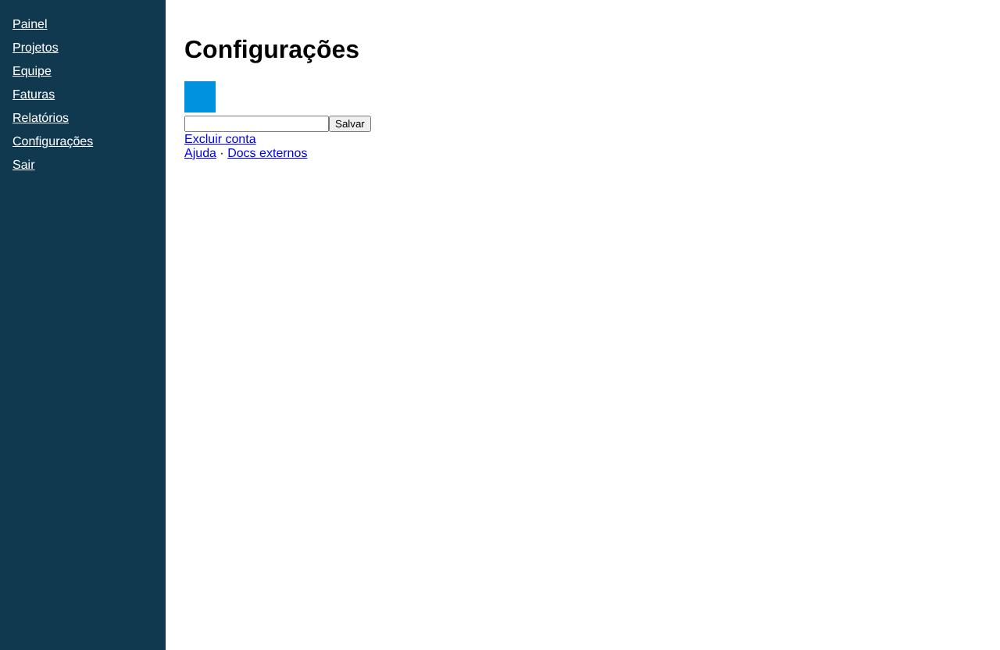

# Configurações

- **Rota:** `/settings`
- **Exemplos visitados:** `http://127.0.0.1:4020/settings`
- **Caminho:** Início › Configurações

## Achados (6)

### **CRÍTICA** · Acessibilidade · Acessibilidade: Form elements must have labels

Ensure every form element has a label. Regra axe `label`. https://dequeuniversity.com/rules/axe/4.14/label?application=playwright

**Evidências**

- /settings: input

**Como reproduzir**

1. Início
2. Configurações

**Sugestão:** Element does not have an implicit (wrapped) <label> Element does not have an explicit <label>

`id: 184f66be55`

### **CRÍTICA** · Acessibilidade · Acessibilidade: Images must have alternative text

Ensure  elements have alternative text or a role of none or presentation. Regra axe `image-alt`. https://dequeuniversity.com/rules/axe/4.14/image-alt?application=playwright

**Evidências**

- /settings: img

**Como reproduzir**

1. Início
2. Configurações

**Sugestão:** Element does not have an alt attribute aria-label attribute does not exist or is empty

`id: 8a50490b34`

### **MÉDIA** · UX · "Excluir conta" sem destaque de perigo e colado às ações comuns

> Opinião do agente (confiança 80%): não é uma medição objetiva.

Uma ação destrutiva e irreversível aparece como link azul comum, com o mesmo peso de "Ajuda", logo abaixo de "Salvar". Isso aumenta o risco de clique por engano e não indica a gravidade da ação.

**Evidências**

- Link "Excluir conta" no mesmo estilo de "Ajuda" e "Docs externos", imediatamente abaixo do botão "Salvar"

**Como reproduzir**

1. Início
2. Configurações

**Sugestão:** Mover para uma seção "Zona de perigo" separada, com estilo de alerta (vermelho) e uma etapa de confirmação.

`id: 2514cf6d60`

### **MÉDIA** · UX · Campo de texto sem rótulo

> Opinião do agente (confiança 85%): não é uma medição objetiva.

O único campo da página não tem rótulo nem placeholder, então o usuário não sabe o que preencher nem o que o botão "Salvar" vai alterar.

**Evidências**

- Campo de texto vazio, sem rótulo visível, logo abaixo do quadrado azul e ao lado do botão "Salvar"

**Como reproduzir**

1. Início
2. Configurações

**Sugestão:** Colocar um rótulo visível que descreva o dado (ex.: "Nome de exibição") e um texto de ajuda, se necessário.

`id: 1c0211b12c`

### **MÉDIA** · UX · Configurações sem seções nem agrupamento

> Opinião do agente (confiança 65%): não é uma medição objetiva.

Os elementos estão empilhados sem espaçamento, títulos de seção ou agrupamento. O campo e o botão ficam colados e não fica claro a qual parte das configurações cada controle pertence.

**Evidências**

- Quadrado azul, campo + "Salvar", "Excluir conta" e "Ajuda · Docs externos" empilhados sem espaço entre si e sem subtítulos

**Como reproduzir**

1. Início
2. Configurações

**Sugestão:** Dividir em seções com subtítulos (Perfil, Conta etc.) e aplicar espaçamento consistente entre os grupos.

`id: f318d7f100`

### **MÉDIA** · UX · Quadrado azul sem identificação

> Opinião do agente (confiança 70%): não é uma medição objetiva.

Há um bloco azul sólido sem texto ou legenda. Pode ser um avatar, uma cor de tema ou um logo, mas a tela não deixa claro o que ele é nem se dá para interagir com ele.

**Evidências**

- Quadrado azul de ~40px abaixo do título "Configurações", sem texto associado

**Como reproduzir**

1. Início
2. Configurações

**Sugestão:** Incluir uma legenda (ex.: "Foto de perfil") e uma ação explícita ("Alterar"), ou remover o elemento se for só decorativo.

`id: 3dae65f7b1`
