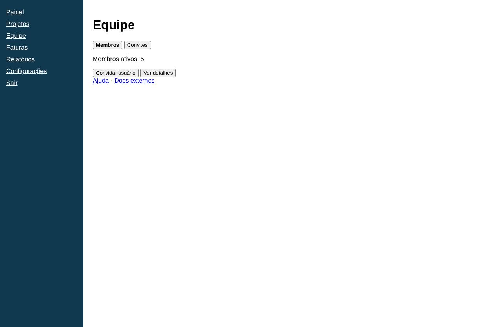
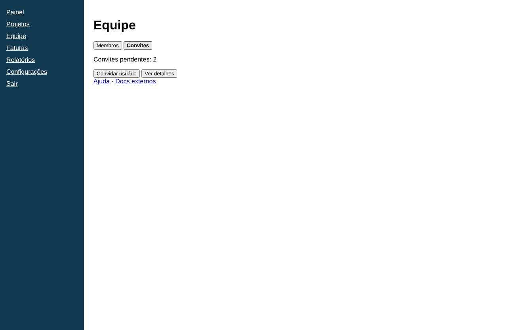
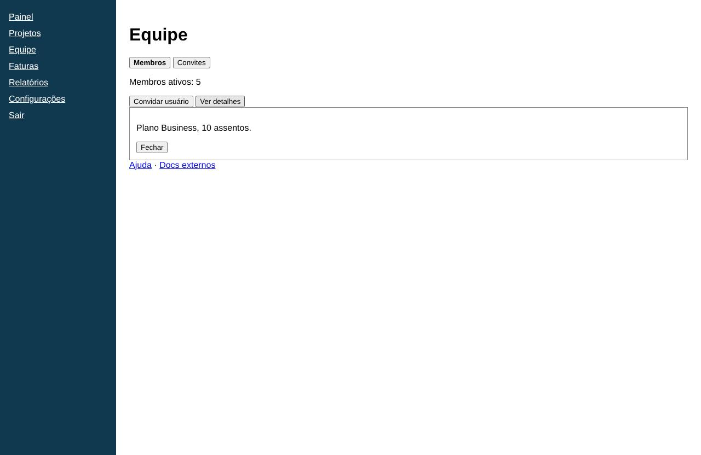

# Equipe

- **Rota:** `/team`
- **Exemplos visitados:** `http://127.0.0.1:4020/team`
- **Caminho:** Início › Equipe

## Subestados

### aba Convites

### aba Membros

### Ver detalhes

## Achados (5)

### **MÉDIA** · UX · Aba ativa pouco diferenciada

> Opinião do agente (confiança 75%): não é uma medição objetiva.

As abas "Membros" e "Convites" parecem botões comuns. A aba selecionada só aparece em negrito, sem outro indicador claro de estado, o que dificulta saber qual visão está aberta.

**Evidências**

- Botões "Membros" (em negrito) e "Convites" com o mesmo estilo de botão padrão

**Como reproduzir**

1. Início
2. Equipe

**Sugestão:** Usar um componente de abas com indicador visual forte (sublinhado ou cor de fundo) e aria-selected.

`id: 92174c5c77`

### **MÉDIA** · UX · Ação principal sem destaque

> Opinião do agente (confiança 70%): não é uma medição objetiva.

"Convidar usuário" deveria ser a ação principal, mas tem o mesmo peso visual de "Ver detalhes" e aparece colado a ele.

**Evidências**

- Botões "Convidar usuário" e "Ver detalhes" lado a lado com estilo idêntico

**Como reproduzir**

1. Início
2. Equipe

**Sugestão:** Estilizar "Convidar usuário" como botão primário e separá-lo das ações secundárias.

`id: 73c57d8dd4`

### **MÉDIA** · UX · Lista de membros ausente na aba Membros

> Opinião do agente (confiança 70%): não é uma medição objetiva.

A aba Membros mostra só uma contagem e não lista os membros. O usuário não consegue ver quem faz parte da equipe nem gerenciar ninguém diretamente.

**Evidências**

- Único conteúdo da aba: "Membros ativos: 5"

**Como reproduzir**

1. Início
2. Equipe

**Sugestão:** Exibir uma tabela de membros com nome, e-mail, papel e ações por linha.

`id: c8ec7b259f`

### **MÉDIA** · UX · Rótulo "Ver detalhes" ambíguo

> Opinião do agente (confiança 65%): não é uma medição objetiva.

Não fica claro de que são os detalhes: da equipe, dos membros ou dos convites.

**Evidências**

- Botão "Ver detalhes"

**Como reproduzir**

1. Início
2. Equipe

**Sugestão:** Usar um rótulo específico, como "Ver membros" ou "Detalhes da equipe".

`id: 2c37f9533a`

### **BAIXA** · UX · Links de ajuda colados aos botões de ação

> Opinião do agente (confiança 55%): não é uma medição objetiva.

Os links "Ajuda · Docs externos" ficam logo abaixo dos botões, sem espaçamento, e parecem fazer parte do grupo de ações.

**Evidências**

- "Ajuda · Docs externos" imediatamente abaixo de "Convidar usuário" e "Ver detalhes"

**Como reproduzir**

1. Início
2. Equipe

**Sugestão:** Separar os links de ajuda com espaçamento ou movê-los para uma área de suporte.

`id: 2cb6370026`
